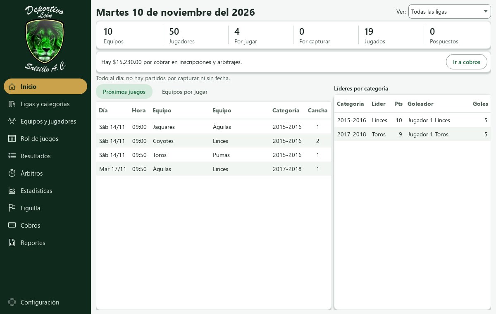
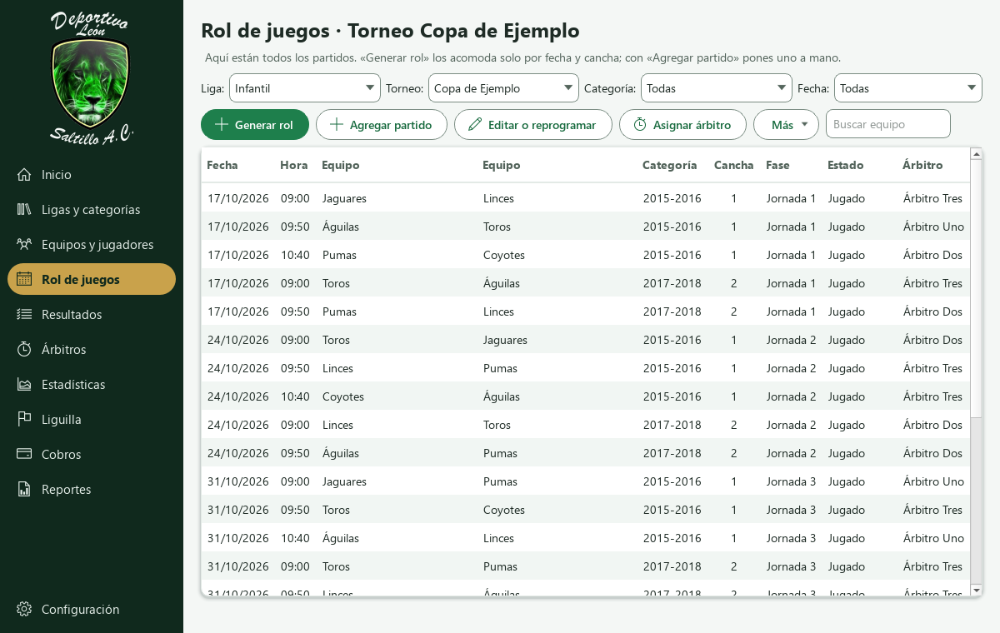
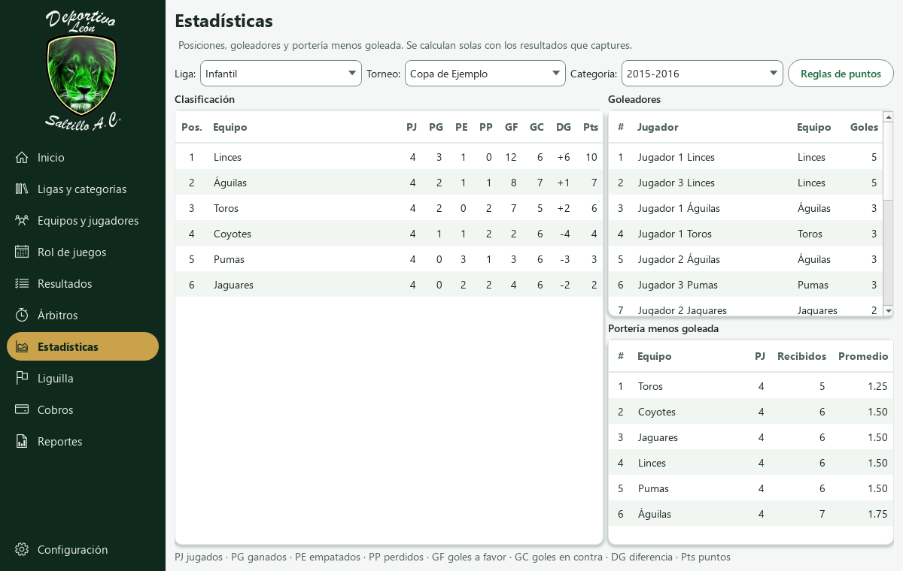
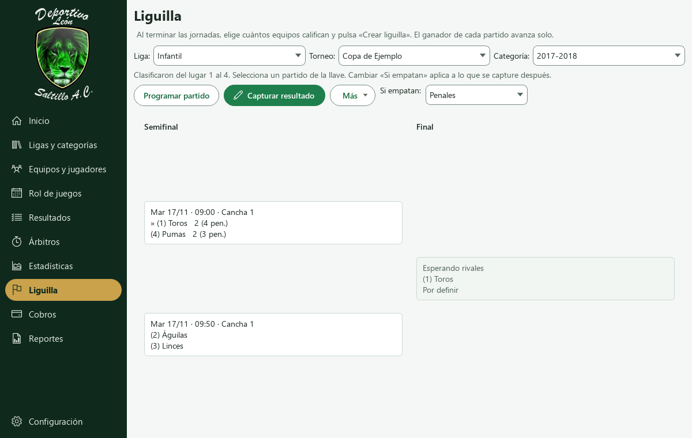
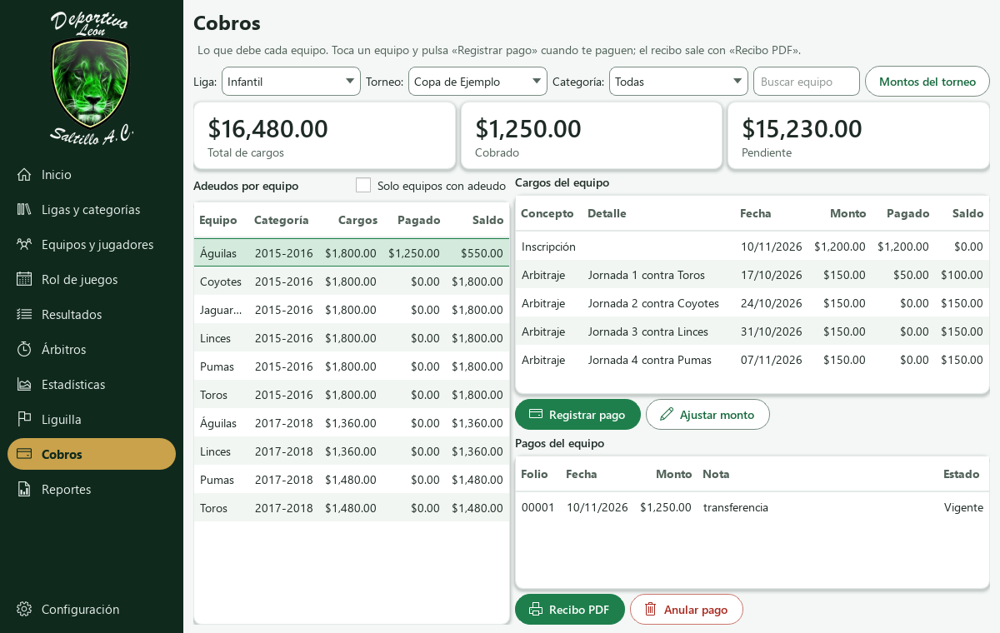
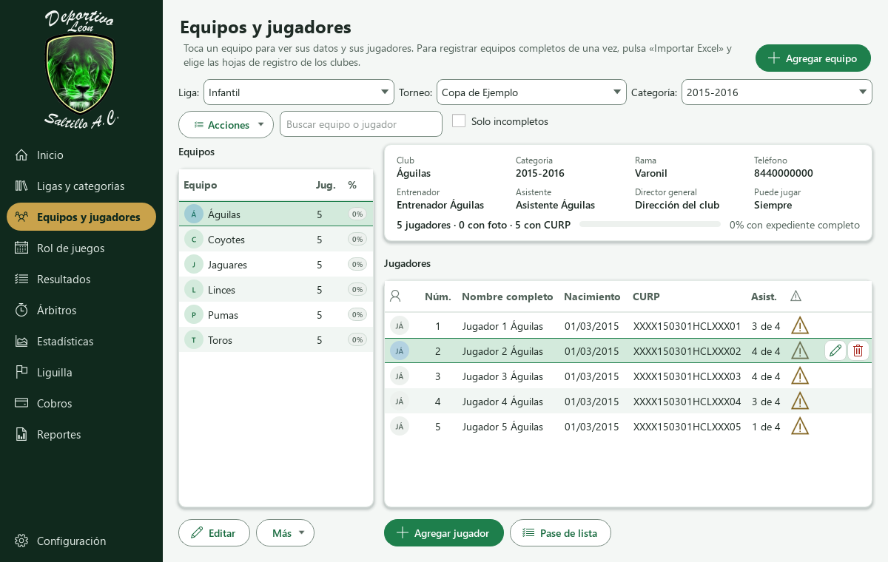
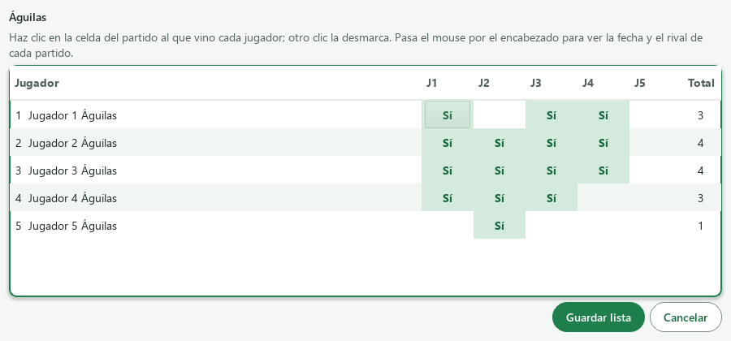
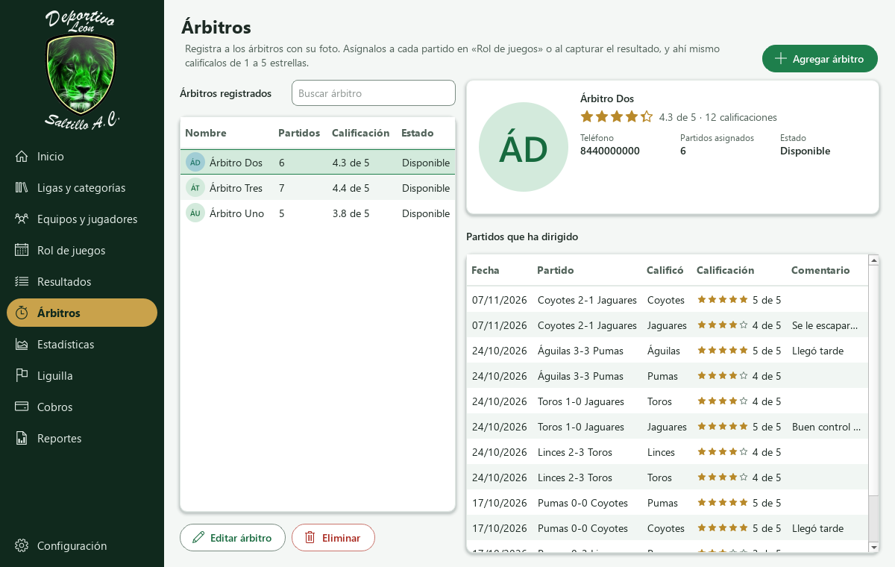
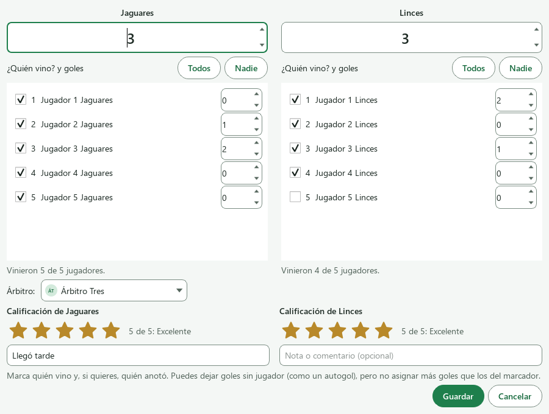
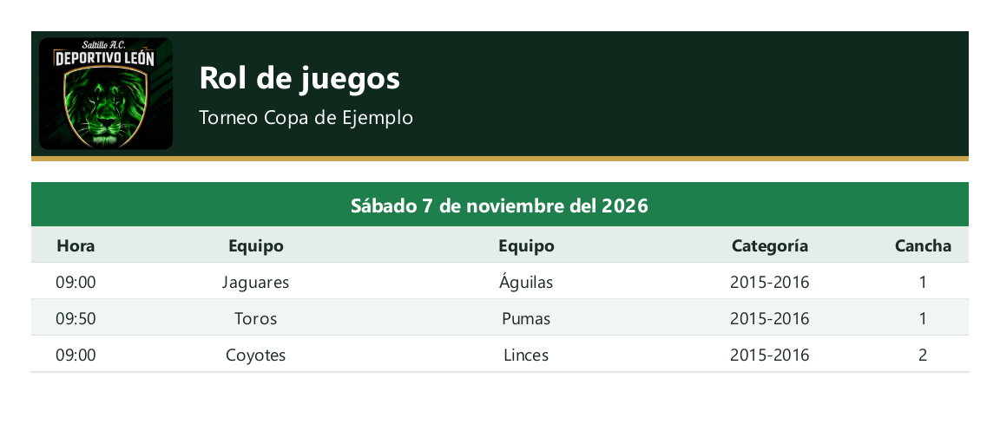

  

  <h1>Deportivo León</h1>

  
<strong>Programa de escritorio para organizar una liga de futbol: equipos, rol de juegos,
  resultados, estadísticas, liguilla, cobros y reportes.</strong>

  

    <a href="https://github.com/Shifu17/Dep.Leon-/releases/latest"><strong>Descargar para Windows</strong></a>
    ·
    <a href="docs/GUIA_DE_USO.md">Guía de uso</a>
    ·
    <a href="docs/REQUISITOS.md">Reglas de la liga</a>
    ·
    <a href="docs/DESARROLLO.md">Guía técnica</a>
  

## Para qué sirve

Deportivo León reúne en un solo programa lo que normalmente se lleva en hojas sueltas: quién juega,
cuándo, cómo van las tablas y quién debe cuánto. Funciona **sin internet**, en una sola computadora, y
tus datos se quedan en ella.

| Área | Qué puedes hacer |
|---|---|
| **Ligas y categorías** | Administrar ligas por día, Fut 7 y Fut 11, categorías por año de nacimiento y torneos. |
| **Equipos y jugadores** | Importar de una vez las hojas de registro de Excel de los clubes, de todas las categorías, o registrar a mano, con foto, CURP y credenciales en PDF. |
| **Pase de lista** | Anotar quién vino a cada partido y ver la asistencia de cada jugador, como las columnas J1, J2… de la hoja de registro. |
| **Rol de juegos** | Generar jornadas, repartir partidos según la disponibilidad de cada equipo y evitar empalmes de cancha. |
| **Resultados** | Capturar marcadores y goleadores, posponer partidos o darlos por default indicando quién paga. |
| **Árbitros** | Registrar árbitros con foto, asignar uno a cada partido y que cada equipo lo califique de 1 a 5 estrellas, con su comentario. |
| **Estadísticas** | Consultar clasificación, tabla de goleadores y portería menos goleada, con puntos configurables. |
| **Liguilla** | Elegir el rango de clasificados y armar la llave a partido único; el ganador avanza solo hasta el campeón. |
| **Cobros** | Llevar inscripciones, arbitrajes, abonos y adeudos, con recibos en PDF. |
| **Reportes** | Generar PDF para imprimir e imágenes para compartir por WhatsApp. |

## Cómo se ve

| Rol de juegos | Estadísticas |
|---|---|
|  |  |

| Liguilla | Cobros |
|---|---|
|  |  |

| Equipos y jugadores | Pase de lista |
|---|---|
|  |  |

| Árbitros | Calificar al árbitro |
|---|---|
|  |  |

**Imagen lista para WhatsApp:**

> Todas las capturas usan equipos y resultados inventados.

## Empezar en 3 pasos

1. Descarga `DeportivoLeon.exe` desde la [última versión](https://github.com/Shifu17/Dep.Leon-/releases/latest).
   No necesitas instalar nada más.
2. Ábrelo. Si Windows muestra «Windows protegió su PC», es porque el programa no tiene firma digital:
   pulsa **Más información** y luego **Ejecutar de todas formas**.
3. Crea tu cuenta y **guarda el código de recuperación** fuera de la computadora. Es la única forma de
   volver a entrar si olvidas la contraseña.

La [guía de uso](docs/GUIA_DE_USO.md) sigue el recorrido completo, desde crear un torneo hasta sacar
reportes.

## Tus datos

- Se guardan solo en tu computadora, en `%LOCALAPPDATA%\DeportivoLeon`, y **nunca se suben a este
  repositorio**.
- Sin internet el programa funciona igual. Con internet, solo consulta si hay una versión nueva, te avisa
  y la instala únicamente si aceptas, después de crear un respaldo.
- La contraseña protege la entrada al programa, pero **no cifra los datos**. Crea respaldos desde
  **Configuración** y guárdalos en un lugar seguro, porque contienen datos y fotos de jugadores.

## Documentación

| Documento | Para quién |
|---|---|
| [Guía de uso](docs/GUIA_DE_USO.md) | Quien administra la liga. |
| [Reglas de la liga](docs/REQUISITOS.md) | Quien quiera saber cómo decide el programa: puntos, desempates, cobros. |
| [Guía técnica](docs/DESARROLLO.md) | Quien vaya a modificar o publicar el programa. |

## Estado del proyecto

En desarrollo activo, con las 6 etapas planeadas ya construidas. Está probado con pruebas automáticas y
**falta su validación en uso real con los datos de la liga**. Funciona solo en Windows y está pensado para
una sola computadora y una sola cuenta.
