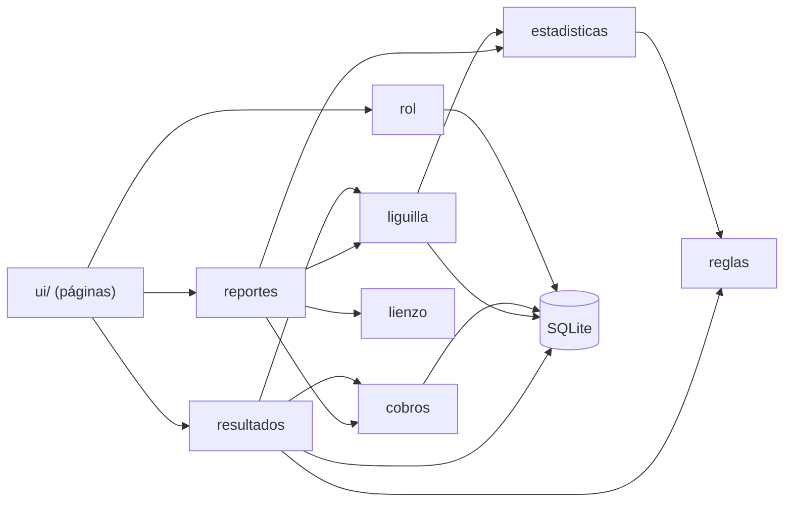

# Guía técnica

Cómo está hecho el programa y cómo modificarlo, probarlo y publicarlo.

**Tecnologías:** Python 3.12, PySide6 (interfaz), SQLite (datos), ReportLab (recibos y credenciales),
openpyxl (Excel), Pillow (fotos), pytest (pruebas) y PyInstaller (ejecutable).

## Preparar el entorno

```powershell
python -m venv .venv
.venv\Scripts\python -m pip install -r requirements-dev.txt
.venv\Scripts\python main.py      # abrir el programa
.venv\Scripts\python -m pytest    # correr las pruebas
```

Los datos se guardan en `%LOCALAPPDATA%\DeportivoLeon`, fuera del repositorio. Para probar sin tocarlos,
define la variable `DEP_LEON_DATA` con otra carpeta.

## Estructura

```text
Dep.Leon-/
├── main.py                  Punto de entrada
├── DeportivoLeon.spec       Configuración del ejecutable
├── dep_leon/
│   ├── db.py                Esquema, datos iniciales, respaldo y restauración
│   ├── paths.py             Ubicación de datos y recursos
│   ├── acceso.py            Cuenta, contraseña y código de recuperación
│   ├── jugadores.py         Validación de edad y manejo de fotos
│   ├── excel.py             Plantilla e importación de jugadores
│   ├── credenciales.py      Credenciales en PDF
│   ├── rol.py               Jornadas, horarios, disponibilidad y empalmes
│   ├── reglas.py            Puntos y marcador del default por torneo
│   ├── resultados.py        Marcadores, goleadores y defaults
│   ├── estadisticas.py      Clasificación, goleadores y portería
│   ├── liguilla.py          Llave y avance de equipos
│   ├── cobros.py            Montos, cargos, pagos y adeudos
│   ├── recibos.py           Recibo en PDF
│   ├── inicio.py            Datos de la pantalla de inicio
│   ├── reportes.py          Contenido de los reportes
│   ├── lienzo.py            Dibujo de los reportes en PDF e imagen
│   ├── updater.py           Actualizaciones desde GitHub
│   ├── assets/              Logo, ícono y flechas
│   └── ui/                  Ventana, tema y una página por sección
├── tests/                   Pruebas con pytest
├── scripts/capturas.py      Genera las capturas de la documentación
└── docs/                    Documentación y capturas
```

La lógica vive en `dep_leon/` y la interfaz en `dep_leon/ui/`. Las reglas se prueban sin abrir ventanas.

## Cómo se conectan los módulos



Al capturar un resultado, `resultados.py` guarda el marcador, genera los cargos de arbitraje y hace avanzar
la llave **en una sola transacción**: si un paso falla, no queda nada a medias.

## Decisiones de diseño

| Decisión | Motivo |
|---|---|
| El dinero se guarda en centavos enteros | Evita errores de redondeo. |
| El arbitraje se cobra al capturar el resultado | Los partidos pospuestos o cancelados no generan cargos que corregir. |
| Los pagos se anulan, no se borran | Los folios deben conservarse y no reutilizarse. |
| Los datos viven fuera de la carpeta del programa | Una actualización no puede tocarlos. |
| Las novedades del esquema van en tablas nuevas | `CREATE TABLE IF NOT EXISTS` actualiza bases y respaldos anteriores sin migraciones. |
| Los partidos de liguilla son partidos normales ligados a una llave | Reutilizan rol, captura y cobros. Sus jornadas empiezan en 101 (`rol.BASE_LIGUILLA`). |
| Restaurar un respaldo conserva la cuenta actual | Un respaldo no debe cambiar quién puede entrar. |
| Las contraseñas se guardan con scrypt y sal | Nunca se guarda la contraseña ni el código de recuperación. |
| Un mismo código dibuja PDF, imagen y vista previa | Los tres salen iguales. |

## Pruebas

```powershell
.venv\Scripts\python -m pytest
```

Las pruebas de interfaz corren sin abrir ventanas. Sin pantalla, Qt puede no cargar las fuentes del
sistema, por lo que `scripts/capturas.py` las registra aparte.

Antes de hacer cambios en la interfaz, revisa también el resultado con el programa abierto: las pruebas
no sustituyen verlo en pantalla normal.

## Actualizar las capturas

```powershell
.venv\Scripts\python scripts\capturas.py
```

Usa una carpeta temporal y datos inventados, así que no toca tus datos. **No uses datos reales en las
capturas:** el repositorio es público.

## Generar el ejecutable

```powershell
.venv\Scripts\pyinstaller --noconfirm DeportivoLeon.spec
```

El resultado queda en `dist\DeportivoLeon.exe`. Cierra el programa antes, porque Windows bloquea un `.exe`
abierto.

## Publicar una versión

El programa instalado consulta la última versión publicada en GitHub Releases, y solo instala un archivo
cuya huella SHA-256 coincida con la publicada.

1. Sube `__version__` en `dep_leon/__init__.py`, corre las pruebas y haz el commit.
2. Genera el ejecutable.
3. Calcula la huella:

   ```powershell
   (Get-FileHash dist\DeportivoLeon.exe -Algorithm SHA256).Hash | Set-Content -NoNewline dist\DeportivoLeon.exe.sha256
   ```

4. Publica con la etiqueta `vX.Y.Z`:

   ```powershell
   gh release create v1.0.0 dist\DeportivoLeon.exe dist\DeportivoLeon.exe.sha256 --notes "Qué cambió"
   ```

Los archivos deben llamarse exactamente así, y la versión no debe marcarse como preliminar. De lo
contrario, el programa no la detecta.

## Cuidado con los datos

El repositorio es público. **Nunca subas** la base de datos, fotos, respaldos ni archivos de Excel con
datos de jugadores, muchos de ellos menores de edad. `.gitignore` excluye `*.db`, `*.xlsx`, `fotos/` y
los respaldos con su nombre sugerido, pero revisa siempre qué vas a subir.
