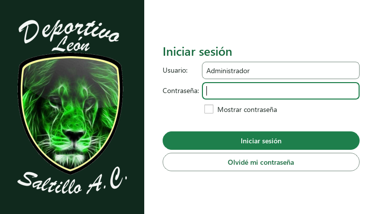
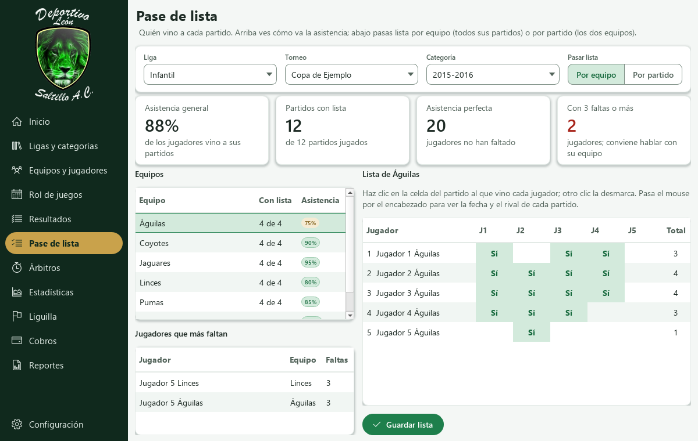
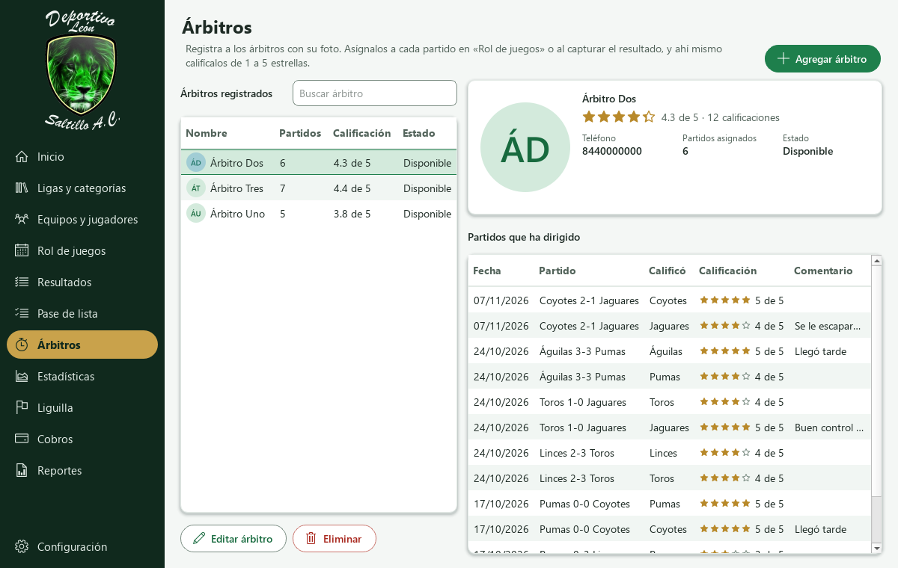
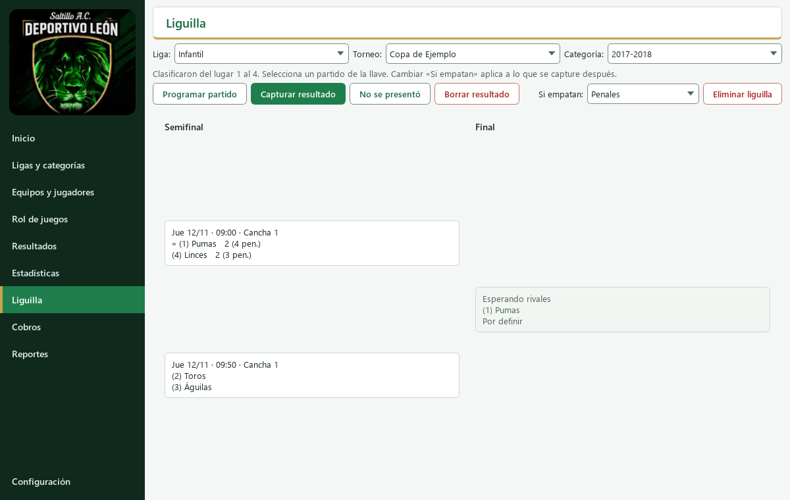
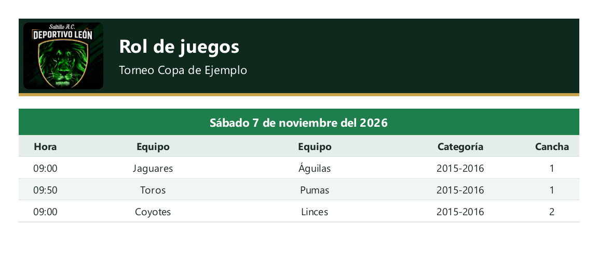

# Guía de uso

Este es el recorrido normal de un torneo, de principio a fin. Cada paso depende del anterior, así que
conviene seguirlos en orden la primera vez.

**Contenido**

1. [Entrar al programa](#1-entrar-al-programa)
2. [Preparar la liga y el torneo](#2-preparar-la-liga-y-el-torneo)
3. [Registrar equipos y jugadores](#3-registrar-equipos-y-jugadores)
4. [Generar el rol de juegos](#4-generar-el-rol-de-juegos)
5. [Capturar resultados](#5-capturar-resultados)
6. [Consultar estadísticas](#6-consultar-estadísticas)
7. [Jugar la liguilla](#7-jugar-la-liguilla)
8. [Llevar los cobros](#8-llevar-los-cobros)
9. [Sacar reportes](#9-sacar-reportes)
10. [Respaldos y actualizaciones](#10-respaldos-y-actualizaciones)
11. [Atajos y búsqueda](#11-atajos-y-búsqueda)
12. [Si algo no sale](#12-si-algo-no-sale)

## 0. La pantalla de Inicio

Inicio muestra la fecha de hoy y, debajo de las cifras de la liga, una lista de **pendientes**: partidos
por capturar, partidos sin fecha, dinero por cobrar o el siguiente paso si apenas empiezas. Cada pendiente
tiene un botón que te lleva a resolverlo. Más abajo están los próximos juegos, los equipos que juegan el
próximo día y los líderes de cada categoría.

## 1. Entrar al programa

La primera vez, crea tu usuario y contraseña. El programa te mostrará un **código de recuperación**:
anótalo y guárdalo fuera de la computadora. Si olvidas la contraseña, es la única forma de volver a
entrar, y no se puede consultar después.

Después de 5 intentos fallidos, el programa pide esperar 30 segundos. Puedes cambiar la contraseña o
cerrar sesión en **Configuración**.

## 2. Preparar la liga y el torneo

Entra a **Ligas y categorías** y selecciona una liga:

- **Ligas:** ya vienen creadas Femenil, Libre Martes, Libre Miércoles, Libre Jueves, Infantil y Fut 11.
  Puedes editarlas o agregar otras.
- **Categorías:** las infantiles ya vienen cargadas, de 2009-2010 a 2019-2020. Para las demás ligas,
  agrega las que uses. Marca **Sin límite de edad** en la categoría libre. Los años se ven como «2012» si
  es uno solo, o «2009–2010» si son varios.
- **Torneos:** agrega uno con su temporada, siempre con los dos años: **2026-2027**. Si escribes «2026-27»
  o «2026/2027», el programa lo deja como «2026-2027». **Este paso es necesario** antes de registrar
  equipos. Cada torneo muestra su estado: **Próximo** (aún sin resultados), **Activo** (ya hay resultados y
  faltan partidos) o **Finalizado** (ya se jugaron todos).

Las ligas aparecen en el orden de la semana, de lunes a domingo, y al abrir el programa se elige sola la
liga que juega ese día. En las listas de liga, junto a cada nombre aparece su día.

**Modalidad de cada categoría:** la liga dice si es Fut 7 o Fut 11, pero cada categoría puede jugar
distinto. En las infantiles, por ejemplo, las chicas pueden ir en Fut 7, otras en Fut 8 y las grandes en
Fut 9. Al agregar o editar la categoría elige **Se juega en**; si dejas «Igual que la liga», usa la de la
liga. La columna **Juego** muestra la de cada una. Al generar el rol:

- **Fut 7 y Fut 8** se juegan en la Cancha 1 o la Cancha 2 (pueden ir dos partidos a la vez).
- **Fut 9 y Fut 11** ocupan la cancha completa: a esa hora no se juega nada más.

En el rol y en los reportes, la cancha completa aparece como «Completa».

Si dos categorías comparten años (por ejemplo «2011-2012» y «2012»), la tabla las marca con ⚠: un jugador
cabría en las dos. Al guardar una categoría así, el programa te pregunta. Si escribes el nombre como
«2009-10», queda como «2009-2010» y los años de nacimiento se llenan solos.

La tabla de ligas dice cuántas categorías y equipos tiene cada una. Debajo de Categorías y de Torneos está
**Agregar**; para editar o eliminar, usa el botón **Más** o el clic derecho sobre la fila.

## 3. Registrar equipos y jugadores

Entra a **Equipos y jugadores** y elige liga y torneo. Hay dos formas de registrar jugadores.

### Desde las hojas de registro de los clubes (recomendado)

Es el Excel que entrega cada club: **NOMBRE DEL CLUB**, **CATEGORÍA** y **RAMA** arriba; abajo la lista con
**NO. PLAYERA**, **NOMBRE COMPLETO**, **FECHA DE NACIMIENTO**, **CURP** y las columnas J1, J2…; al final
el entrenador, el asistente y el director general. Si trae la hoja **Cédula** con las fotos de las
credenciales, las fotos también se importan.

1. Pulsa **Acciones → Importar Excel** y elige uno o **varios** archivos a la vez (mantén Ctrl para elegir varios).
   Cada hoja de registro es un equipo, de la categoría que sea.
2. Revisa la vista previa. Cada equipo aparece con su categoría en el programa:
   - Si la encuentra, ya viene elegida (por nombre o por año de nacimiento, como «2014» en «2013-2014»).
   - Si no existe, propone **Crear nueva** y la crea al importar, sin límite de edad.
   - Puedes cambiarla en la lista; los jugadores se revisan otra vez al momento.
3. Toca un equipo para ver sus jugadores. Los que tienen error salen en rojo y no se registran.
4. Pulsa **Importar**.

El equipo se crea solo con su entrenador, asistente y director general. El número de playera y la CURP
son opcionales: un jugador sin número aparece como «Sin número».

**Para actualizar los datos**, vuelve a importar la hoja de registro corregida: los jugadores se
actualizan (número, CURP y foto), no se duplican, y el personal del equipo se reemplaza por el del
archivo. Un dato vacío en el archivo no borra lo que ya tenías.

### Exportar la hoja de registro

Pulsa **Acciones → Exportar Excel** y elige:

- **Solo el equipo elegido**, o
- **Todos los equipos de la lista**: guarda un archivo por equipo en la carpeta que elijas (usa el filtro
  de categoría para exportar solo una).

El archivo tiene el **mismo formato** que entregan los clubes: la hoja **Hoja de Registro** con los datos,
los jugadores y el pase de lista marcado en J1, J2…, y la hoja **Cédula** con las credenciales armadas,
con escudo y foto de cada jugador. Se puede volver a importar.

### Credenciales

Pulsa **Acciones → Credenciales PDF** con el equipo elegido. Si a algún jugador le falta foto o CURP, el
programa te avisa cuántos son antes de generarlas. Salen con el acomodo de la cédula de los clubes: escudos,
foto, nombre, CURP, club, fecha de nacimiento, categoría, rama, número de playera, entrenador y director
general. Caben 10 por hoja carta, con una línea gris para recortar.

### Desde la plantilla del programa

En **Más**, debajo de la lista de equipos, elige **Descargar plantilla de Excel vacía**; la hoja
**Instrucciones** explica cómo llenarla. Si hay fotos, ponlas en la misma carpeta que el Excel o en una
subcarpeta `fotos` y escribe el nombre del archivo en la columna **Foto**. Después pulsa **Acciones →
Importar Excel**.

En los dos casos, el programa revisa que la fecha de nacimiento corresponda a la categoría y que no se
repita el número de playera en un equipo.

### A mano

Pulsa **Agregar equipo**, arriba a la derecha (nombre del club, categoría, rama, entrenador, asistente,
director general y teléfono) y, con el equipo elegido, **Agregar jugador** (número, nombre completo, fecha de
nacimiento, CURP, posición y foto).

### Cómo se ve un equipo

Al tocar un equipo, la tarjeta de arriba muestra sus datos como vienen en la hoja de registro: club,
categoría, rama, teléfono, entrenador, asistente, director general y en qué días puede jugar. Lo que falta
dice «Sin dato». Abajo de los datos está el resumen, por ejemplo «23 jugadores · 20 con foto · 18 con CURP», y
una barra con el porcentaje de jugadores con expediente completo (foto, CURP y número). Ese porcentaje
también aparece en la lista de equipos.

En la tabla de jugadores:

- La primera columna es su foto en un círculo; si no tiene, sus iniciales.
- **Avisos:** un ⚠ ámbar si le falta CURP, foto o número, y uno rojo si su año de nacimiento no entra en la
  categoría (pasa el mouse para ver el motivo). En categorías sin límite de edad no se revisa el año.
  Marca **Solo incompletos**, junto al buscador, para ver solo a quienes les falta algo.
- **Número:** haz doble clic en el número para cambiarlo ahí mismo. Si otro jugador del equipo ya lo
  tiene, el programa no lo guarda y te avisa.
- **Editar o eliminar:** al elegir un jugador aparecen el lápiz y el bote de basura al final de su
  renglón; también puedes usar el clic derecho.

Cada vez que guardas algo, la barra verde de abajo lo confirma, por ejemplo «Listo: jugador guardado.».

### Pase de lista

El pase de lista tiene su propia sección en el menú: **Pase de lista**. Arriba están las cifras generales
del torneo (o de la categoría elegida):

- **Asistencia general:** qué porcentaje de los jugadores vino a los partidos en que se pasó lista.
- **Partidos con lista:** en cuántos de los partidos jugados ya se pasó lista.
- **Asistencia perfecta:** cuántos jugadores no han faltado.
- **Con 3 faltas o más:** cuántos jugadores conviene revisar con su equipo; aparecen en la lista
  **Jugadores que más faltan**.

Un partido sin lista no cuenta como falta. En **Pasar lista** eliges cómo trabajar:

- **Por equipo:** toca un equipo y marca su cuadrícula, como la de la hoja de registro: un renglón por
  jugador y una columna por partido (J1, J2…). Clic en la celda para marcar «Sí» y otro clic para quitarlo;
  después pulsa **Guardar lista**. Si cambias de equipo sin guardar, el programa te pregunta.
- **Por partido:** elige el partido y pulsa **Pasar lista del partido** (o doble clic). Sirve para anotar
  quién llegó antes de que termine.

También se marca al **capturar el resultado**: junto a los goles de cada jugador está la casilla **¿Quién
vino?**, y quien anota gol queda marcado solo. En **Equipos y jugadores**, la columna **Asist.** dice cuántas
veces vino cada jugador (por ejemplo «3 de 4»).

### Otras acciones del equipo

En **Más**, debajo de la lista de equipos, con el equipo seleccionado:

- **Días y horas en que puede jugar:** si no marcas nada, puede jugar siempre.
- **Descargar plantilla de Excel vacía**.
- **Eliminar equipo**.

## 4. Generar el rol de juegos

Entra a **Rol de juegos**, elige el torneo y pulsa **Generar rol**. Después:

1. Marca las categorías. Cada una necesita al menos 2 equipos.
2. Marca los días de juego y el horario de cada día.
3. Indica desde qué fecha empezar, cada cuánto hay un partido (50 minutos por defecto) y qué canchas usar.
4. Si juegan ida y vuelta, marca esa opción.

El programa arma las jornadas y:

- Pone cada jornada en una semana y reparte los partidos entre los días de juego.
- Respeta la disponibilidad de cada equipo.
- Evita empalmes, también con otras ligas. Un partido de Fut 11 ocupa todo el terreno.
- Muestra quién descansa cuando el número de equipos es impar.

Si dos equipos no coinciden en ningún horario, te avisa y deja su partido **sin fecha** para que lo
programes a mano.

Después puedes **Agregar partido** o **Editar o reprogramar**; en **Más** están **Posponer partido** y
**Eliminar partido**. Un partido
pospuesto o sin coincidencia de horarios aparece como **Sin fecha** hasta que le asignes una.

> **Antes de generar de nuevo:** se borra el rol anterior de esas categorías, incluidos los cambios a mano
> y los partidos pospuestos. El programa pide confirmar. Si una categoría ya tiene resultados o liguilla,
> no se puede generar de nuevo.

## 5. Capturar resultados

En **Resultados**, selecciona un partido y pulsa **Capturar resultado**, o haz doble clic en él.

- **Marcador, quién vino y goleadores:** marca a los jugadores que se presentaron y, si quieres, quién
  anotó. Puede haber goles sin jugador, como un autogol, pero no más goles asignados que los del marcador.
- **Corregir:** vuelve a capturar el partido. **Borrar resultado** lo regresa a por jugar.

Los partidos cuya fecha ya pasó sin resultado aparecen como **Atrasado**. Inicio avisa cuántos hay y te lleva
directo a capturarlos.

Si un equipo no llegó, pulsa **No se presentó** y elige:

- **Dar por default:** el equipo presente gana 3-0 (configurable). Indicas quién paga el arbitraje: el
  ausente, el presente, ambos o ninguno.
- **Posponer:** el partido queda pendiente de nueva fecha y no genera cobro.

### Árbitros

En la pantalla **Árbitros** registras a cada árbitro con **Agregar árbitro**: nombre, teléfono y foto. Al
tocar uno ves su ficha, con su promedio de estrellas y los partidos que ha dirigido.

- **Asignar el árbitro de un partido:** en **Rol de juegos**, selecciona el partido y pulsa **Asignar
  árbitro**. También puedes elegirlo al capturar el resultado.
- **Calificarlo:** en **Capturar resultado**, debajo de los jugadores, elige al árbitro. Cada equipo tiene su
  propia calificación: toca de 1 a 5 estrellas (1 Malo, 2 Regular, 3 Bueno, 4 Muy bueno, 5 Excelente) y, si
  quieres, escribe una nota o comentario. Tocar otra vez la misma estrella la quita. Con el teclado: números
  del 1 al 5, o las flechas. El promedio del árbitro junta las calificaciones de todos los equipos.
- **Si un árbitro ya no trabaja con la liga:** **Eliminar** solo borra a los que no tienen partidos. Si ya
  tiene, el programa ofrece **darlo de baja**: deja de aparecer al asignar, pero se conserva su historial.

## 6. Consultar estadísticas

En **Estadísticas**, elige torneo y categoría para ver:

- **Clasificación:** PJ, PG, PE, PP, GF, GC, DG y Pts.
- **Goleadores**.
- **Portería menos goleada**, por equipo.

Con **Reglas de puntos** puedes cambiar los puntos por victoria, empate y derrota, y los goles de un
default. El desempate va por diferencia de goles, goles a favor y resultado entre los empatados.

## 7. Jugar la liguilla

En **Liguilla**, elige torneo y categoría:

1. Indica el rango: **Clasifican del lugar X al lugar Y**.
2. Elige **Si empatan**: penales o mejor lugar en la tabla.
3. Pulsa **Crear liguilla**.
4. Selecciona cada partido de la llave para programarlo y capturar su resultado. En **Más** están
   **No se presentó un equipo**, **Borrar resultado** y **Eliminar liguilla**.

Si los clasificados no completan 2, 4, 8 o 16 equipos, los mejores lugares pasan directo a la siguiente
ronda. El ganador avanza solo hasta llegar al campeón.

Ten en cuenta que:

- La llave usa la tabla del momento y ya no cambia sola. Si faltan partidos regulares, el programa avisa.
- La liguilla **no suma a la tabla regular**, pero sí al goleo y a los cobros de arbitraje.
- No se puede cambiar quién avanza si la siguiente ronda ya tiene resultado. Primero hay que borrarlo.

## 8. Llevar los cobros

En **Cobros**, elige el torneo:

1. Pulsa **Montos del torneo** y escribe el arbitraje y la inscripción de cada categoría. Con un monto en
   cero no se cobra ese concepto.
2. Selecciona un equipo para ver sus cargos.
3. Pulsa **Registrar pago**. Puede ser un abono: se aplica primero al cargo seleccionado y lo que sobre, al
   más antiguo.
4. Selecciona el pago y pulsa **Recibo PDF** para generar su recibo.

**Cuándo se cobra cada cosa:**

- **Inscripción:** una vez por equipo y torneo.
- **Arbitraje:** a cada equipo **al capturar el resultado**, nunca antes. Los partidos pospuestos no se
  cobran.

**Correcciones:**

- **Ajustar monto** cambia un solo cargo. En cero, lo perdona.
- **Anular pago** deja el folio marcado como anulado, y lo que cubría vuelve a quedar pendiente.
- Si pones un monto después de jugar partidos, esos partidos se cobran al ponerlo.
- Un arbitraje con pagos protege su partido: para borrar el resultado, primero hay que anular el pago.

## 9. Sacar reportes

En **Reportes**, elige el reporte y revisa la vista previa:

| Reporte | PDF | Imagen para WhatsApp |
|---|---|---|
| Rol de juegos (una fecha o todas) | Sí | Sí |
| Tabla de posiciones | Sí | Sí |
| Llave de liguilla | Sí | Sí |
| Goleadores y portería menos goleada | Sí | No |
| Adeudos | Sí | No |

**Copiar imagen** te deja pegarla directo en WhatsApp sin guardar un archivo.

## 10. Respaldos y actualizaciones

Ambas opciones están en **Configuración**.

**Respaldos**

- **Crear respaldo** guarda un archivo `.zip` con todos los datos y las fotos. Hazlo seguido y guarda una
  copia fuera de la computadora, por ejemplo en una USB.
- Cuida ese archivo: **no lleva contraseña** y contiene datos de jugadores.
- **Restaurar respaldo** reemplaza toda la información actual, pero conserva tu cuenta.

**Actualizaciones**

Con internet, el programa revisa si hay una versión nueva y te avisa. Solo se instala si aceptas, y antes
crea un respaldo automático. Sin internet no ocurre nada y todo sigue funcionando.

## 11. Atajos y búsqueda

Arriba de cada pantalla, los filtros (liga, torneo, categoría…) van juntos en una tarjeta, cada uno con su nombre arriba. La liga, el torneo y la categoría que eliges se conservan al cambiar de pantalla. Inicio tiene su propia
vista.

Pulsa el encabezado de una columna para ordenar la tabla, y vuelve a pulsarlo para invertir el orden. En
Equipos, Rol, Resultados y Cobros puedes buscar por nombre; en Equipos también encuentra jugadores.

| Tecla | Qué hace |
|---|---|
| **Ctrl+1** a **Ctrl+9** | Cambiar de pantalla, en el orden del menú (Reportes no tiene atajo) |
| **Ctrl+0** | Ir a Configuración |
| **Ctrl+F** | Ir al buscador de la pantalla |
| **F5** | Actualizar la pantalla |
| **Tab** | Pasar al siguiente control |
| **Enter** o doble clic en una fila | Hacer la acción principal: editar, capturar o registrar pago |

## 12. Si algo no sale

| Situación | Qué hacer |
|---|---|
| «Windows protegió su PC» al abrir | Pulsa **Más información** y luego **Ejecutar de todas formas**. El programa no tiene firma digital. |
| Olvidé mi contraseña | Pulsa **Olvidé mi contraseña** y escribe tu código de recuperación. |
| Perdí también el código | El programa no ofrece otra forma de entrar. Pide ayuda técnica y conserva tu carpeta de datos y tus respaldos. |
| No me deja guardar la plantilla o importarla | Cierra el archivo en Excel e inténtalo de nuevo. |
| Un renglón del Excel sale con error | Lee el motivo en la vista previa, corrígelo en Excel y vuelve a importar. |
| No me deja generar el rol | Revisa que la categoría tenga 2 equipos o más y que no tenga resultados ni liguilla. |
| Un partido no aparece para capturar | Revisa que tenga fecha. Los partidos sin fecha se programan en **Rol de juegos**. |
| No me deja eliminar un equipo | Tiene partidos, un lugar en la liguilla o pagos registrados. |
